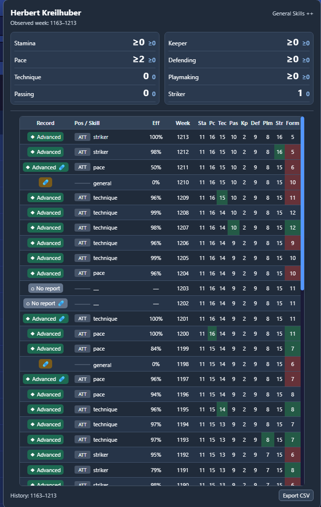
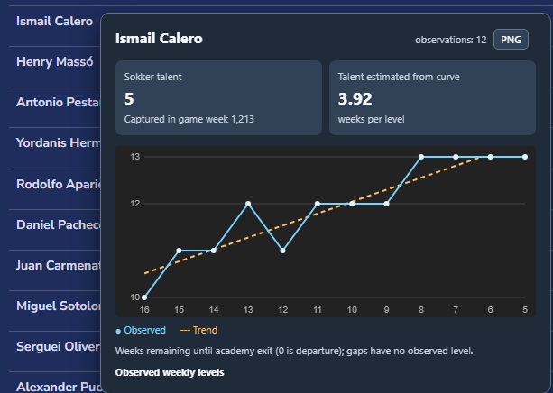
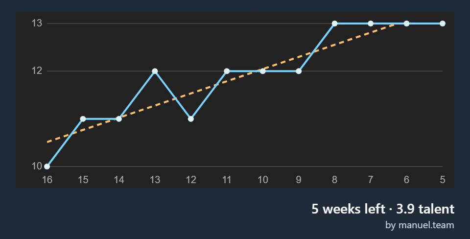

# Feature screenshots

These screenshots show Sokker++ in use with in-game player names and observed game data. They are examples of the interface; the [feature guides](README.md) explain the calculations and limits.

## General Skills summary

The first-team card shows focused training counts for all eight skills above the weekly history table. Each skill also has its own progress chart.

## Junior talent card

The junior card keeps Sokker's talent value separate from the curve estimate. Its Canvas chart shows observed weekly levels and a fitted trend.

## Junior chart export

The PNG export includes the chart and a compact footer with weeks left, estimated talent, and attribution.

Read the [first-team guide](TALENT_SUMMARY.md) and [junior guide](JUNIOR_TALENT.md) for calculation details and limitations.
